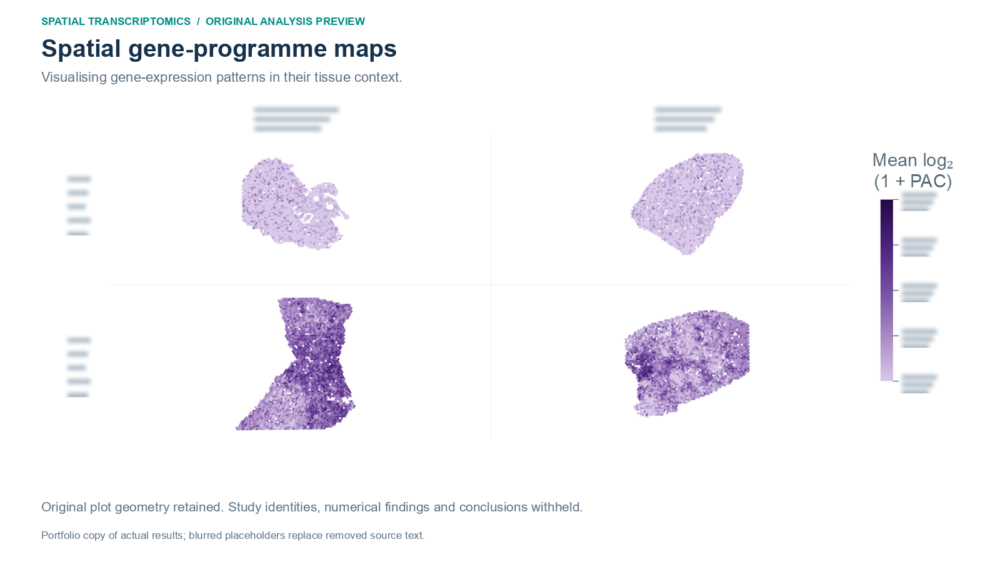
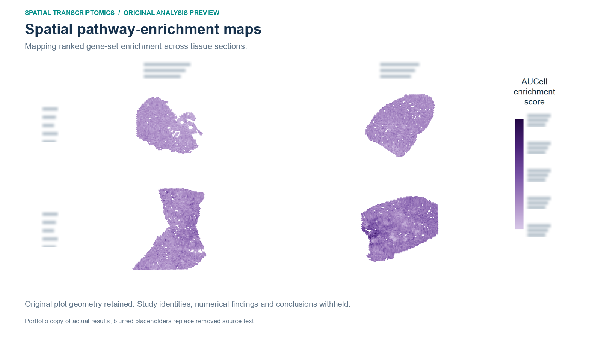
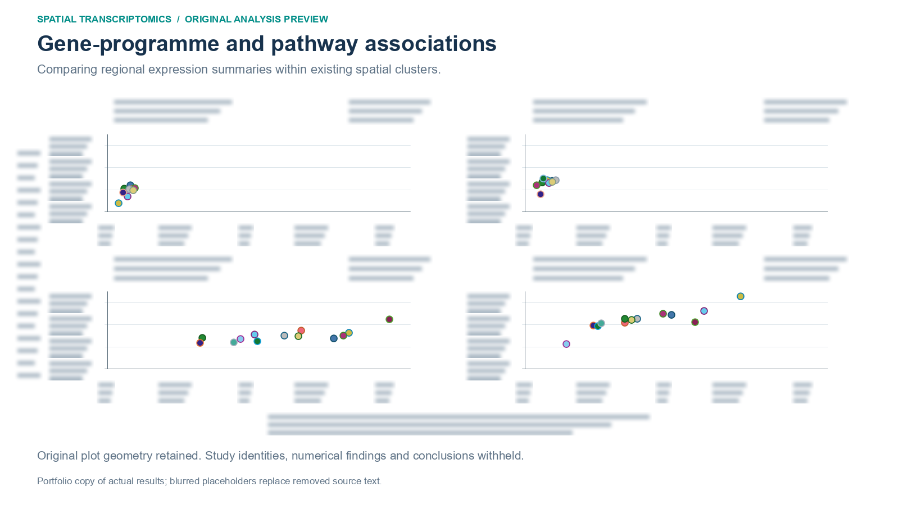

# Ageing and influenza in mouse lung

### Spatial transcriptomics · gene programmes · tissue context

How do immune-associated expression patterns and tissue-maintenance signatures vary across the lung? This project explores those questions through spatial transcriptomics, combining gene expression with the local arrangement of tissue spots.

The public repository presents the analysis methods and selected original result figures with sensitive details obscured. Chart shapes and spatial patterns remain visible; selected study labels, numerical scales, statistical annotations and biological conclusions are withheld. Full-resolution originals, numerical tables and research objects are retained privately.

## What the project produces

The research workflow brings together spatial maps of T-cell-associated gene programmes, individual-gene spatial-variability tests, Hallmark pathway enrichment and profiles of local tissue clusters. These complementary outputs connect molecular readouts with tissue context.

### Spatial programme expression



### Pathway enrichment across tissue



### Local cluster relationships



*These are redacted copies of real result figures. Original chart marks are retained; the previews are not substitute or simulated data. Withheld text pixels are removed and replaced by blurred placeholders. Public images are flattened and contain no original text layer or embedded result tables.*

## Explore the files

| Directory | Contents |
| --- | --- |
| [01_main_analysis](01_main_analysis/) | Ordered methods from import and quality control to spatial clustering, programme scores, pathway enrichment and cluster profiles. |
| [02_preliminary_analysis](02_preliminary_analysis/) | Optional AUCell seed-sensitivity and ordinary Spearman diagnostics, separate from the main workflow. |
| [03_archive](03_archive/) | A retained historical CP10K programme method, clearly separated from the SpaNorm workflow. |
| [04_data](04_data/) | Input requirements and a generic sample-manifest template. Research data are not included. |
| [05_documentation](05_documentation/) | Redacted original-result previews and a description of what is withheld. |

Each analysis area pairs `01_scripts/` with `02_results/`. The results folders explain the expected outputs; they do not contain the private findings. This public collection contains selected, adapted methods. Additional exploratory work, unused results and original execution records remain in the private research archive.

## Use the methods

Read [METHODS.md](METHODS.md) for the input contract, package requirements, parameters and interpretation. Set up your own compatible R/Bioconductor environment and private input manifest, then explicitly run:

```r
source("01_main_analysis/01_scripts/10_run_workflow.R")
result <- run_main("04_data/local/sample_manifest.csv")
```

The public methods are portable adaptations of the producing sources. They have passed static review and R parsing; they have **not** been rerun on the research data or validated end to end in a fresh environment. Generated objects and tables are ignored by Git by default.

## Interpretation

The study has one supplied tissue section per age/time-point condition. Spots may contain multiple cell types, and clusters are section-specific. Programme expression, AUCell enrichment and nnSVG statistics answer different questions: they do not directly establish cell identity, pathway activity or DNA-repair capacity. Cluster associations are descriptive and do not establish replicated age effects or causation.
